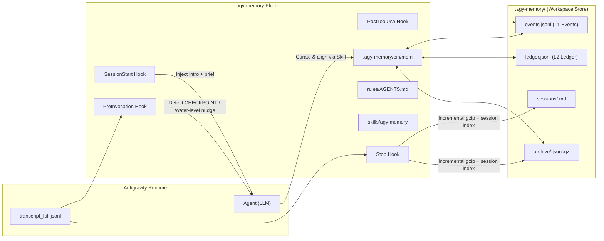

# agy-memory

**Compaction-aware persistent memory for Google Antigravity (`agy`).**  
**面向 Google Antigravity (`agy`) 的抗压缩持久化记忆增强插件。**

Zero external dependencies (Python 3.9+ stdlib only) · No extra API keys · Drop-in Antigravity Plugin (`hooks + rules + skill + CLI`)

---

## Why `agy-memory`? / 为什么需要它？

Antigravity automatically compacts conversation history once context crosses a model-specific backend limit, replacing raw tool outputs and multi-turn history with a prose `<summary>` (`SYSTEM/CHECKPOINT`). While native summaries preserve top-level user prompts well, long-running tasks still suffer from:

1. **Multi-compaction decay (多次压缩叠加失真)** — "summaries of summaries" drop exact identifiers, keys, symbols, and intermediate tool outputs from earlier phases.
2. **Mid-task drift (中途细节稀释)** — subtle constraints, decisions, and observations buried in dozens of tool calls get flattened or omitted.
3. **Cross-session amnesia (跨会话失忆)** — starting a new conversation in the same repo loses prior decisions, constraints, and unfinished progress.
4. **Unverifiable summaries (摘要不可核查)** — native resume rules instruct the agent to treat summary statements as observed truth without re-verifying; once a detail bends, the error sticks.

`agy-memory` pairs **deterministic lifecycle hooks** (capture, compaction detection, water-level nudges) with an **agent-driven skill & CLI (`mem`)** so the agent itself curates an append-only ledger and re-aligns against ground-truth sources right after compaction.

---

## How It Works / 工作原理



### Three-Layer Memory Store (`.agy-memory/`)
- **L0 Raw Ground Truth (`archive/<convId>.jsonl.gz`)**: Incremental multi-member gzip archive of transcripts written on `Stop`. Exact facts carry pointers (`<convId>#<step_index>` or `file:<path>`) so the agent can pull verbatim text via `mem show <convId>#<step>` even if live logs are cleaned up.
- **L1 Event Stream (`events.jsonl`)**: Written deterministically by hooks (`< 50ms`, no LLM calls) — verbatim `user_input`, `file_edit`, `command`, `turn_end` (with `git status`), and `compaction` (preserving agy's native `CHECKPOINT` summary text).
- **L2 Curated Ledger (`ledger.jsonl`)**: Append-only entries written by the agent via `mem`:
  - **Project-scoped**: `constraint`, `decision`, `fact` (shared across sessions in the workspace).
  - **Session-scoped**: `progress`, `open` (isolated per `conversationId` so parallel/new tasks never inherit stale next-steps).
  - Revisions use `mem supersede <id> "..."` to keep full history for long-term traceability.

### Compaction Prevention & Post-Compaction Alignment
1. **Adaptive Water-Level Nudges**: `PreInvocation` tracks `input_tokens + cache_read_tokens` (true context size, immune to prompt-cache misses) and learns each model's actual compaction peak in `state/models.json`. Approaching 75% of that peak triggers a 1-line nudge to save unsaved constraints/decisions/facts *before* compaction hits.
2. **Exact Compaction Detection**: Watches new transcript steps for `SYSTEM/CHECKPOINT` (with a 40% token-drop fallback).
3. **Structured Re-alignment**: Injects the rendered session brief (capped at `1500` tokens by priority: `constraint > session progress > decision > fact`) and instructs the agent to load the `agy-memory` skill to verify constraints and re-ground exact identifiers before its next edit.

---

## Benchmark Results / 评测结果

Evaluated across 5 multi-turn tasks (`Gemini 4 Hydrogen Medium`, headless `agy` CLI in isolated git workspaces; details in [`eval/RESULTS.md`](eval/RESULTS.md)):

| Metric / 指标 | Baseline (Native `agy`) | With `agy-memory` | Delta |
| :-- | :-- | :-- | :-- |
| **Exact Fact Recall / 精确事实召回** | 33 / 43 (76.7%) | **42 / 43 (97.7%)** | **+21.0 pp** |
| **Lost Facts / 事实丢失数** | 10 | **1** *(0 memory loss; 1 turn-1 count off-by-one)* | **-90.0%** |
| **Constraint Recall / 约束复述** | 11 / 12 (91.7%) | **12 / 12 (100%)** | **+8.3 pp** |
| **Uncached Input + Output Tokens** | 4.04M | **4.15M** | **+2.7%** |

Highlights:
- **`t1` (Mid-task constraints + 40 modules, 1 compaction)**: `5/5` vs `1/5` baseline.
- **`t4` (80 modules, 2 consecutive compactions)**: `5/5` vs `3/5` baseline (baseline lost all tool-output identifiers from Phases 1 & 2 across compactions).
- **`t3` (Cross-session handoff)**: `3/4` + `1/1` constraints vs `0/4` + `0/1` baseline.

---

## Installation / 安装方式

**Requirements**: macOS or Linux, `python3` (3.9+) on `PATH`, Antigravity (`agy` CLI / Antigravity 2.0 / IDE).

### Option 1: Global Install via `agy plugin` (Recommended / 推荐全局安装)

```sh
git clone https://github.com/REPLACE_ME/agy-memory-enhance.git
cd agy-memory-enhance
agy plugin validate ./plugin/agy-memory --strict
agy plugin install ./plugin/agy-memory
```

Manage anytime with `agy plugin list`, `agy plugin disable agy-memory`, or `agy plugin enable agy-memory`.

### Option 2: Per-Workspace Install (单项目安装 / 团队共享)

Copy the plugin into your project's `.agents/plugins/` directory:

```sh
sh scripts/install-dev.sh /path/to/your/project
```

By default, `.agy-memory/.gitignore` ignores `*` so local session logs and secrets are never committed accidentally, without touching your repository's root `.gitignore`. Delete `.agy-memory/.gitignore` if you want to version-control project memory.

---

## `mem` CLI Quick Reference / 命令行速查

Hooks automatically generate a workspace shim at `<workspace>/.agy-memory/bin/mem` and pass its path in `[agy-memory]` system messages:

```sh
# Write & update ledger
.agy-memory/bin/mem add constraint "Never modify files under src/legacy/"
.agy-memory/bin/mem add decision "Use SQLite over Postgres: zero-dependency requirement"
.agy-memory/bin/mem add fact "Primary registry key is REG_03_327c8f" --source file:src/m03.py
.agy-memory/bin/mem add progress "Finished Phase 1; next: refactor parser"
.agy-memory/bin/mem done <id>
.agy-memory/bin/mem supersede <id> "Updated rule text"
.agy-memory/bin/mem drop <id>

# Inspect & re-ground
.agy-memory/bin/mem brief
.agy-memory/bin/mem show constraint          # constraint | decision | progress | fact | open | all
.agy-memory/bin/mem show <entry_id>          # full supersede version chain
.agy-memory/bin/mem show <convId>#<stepIdx>  # exact verbatim step from live transcript or gzip archive

# Long-term traceability
.agy-memory/bin/mem search "billing" --where all --since 7d
.agy-memory/bin/mem timeline --file src/core.py
.agy-memory/bin/mem session                  # list sessions or `mem session <convId>`
.agy-memory/bin/mem doctor                   # verify Python, store, hooks & transcript readability
```

---

## Configuration / 配置说明

Optional `<workspace>/.agy-memory/config.json` (all fields have sensible defaults):

```json
{
  "softLimitRatio": 0.75,
  "defaultSoftLimitTokens": 150000,
  "nudgeStepTokens": 30000,
  "compactionDropRatio": 0.4,
  "minPeakTokens": 60000,
  "briefMaxTokens": 1500,
  "sessionInjectBudgetTokens": 6000,
  "stopNudge": true,
  "stopNudgeEdits": 5,
  "archiveTranscripts": true,
  "editToolNames": ["write_file", "edit_file"],
  "redactPatterns": [
    "(?i)(api[_-]?key|secret|token|password)(\\s*[:=]\\s*)\\S+",
    "sk-[A-Za-z0-9_\\-]{16,}",
    "gh[pousr]_[A-Za-z0-9]{20,}"
  ]
}
```

---

## Known Limitations / 已知局限

- **One-call alignment lag**: Antigravity executes auto-compaction *after* `PreInvocation` and right *before* calling the model. Consequently, the first model call immediately following compaction runs on the native summary alone, and `[agy-memory]` injects the alignment brief right before the *next* model call (instructing the agent to audit that post-compaction step as well).
- **Internal transcript schema**: Compaction detection reads `transcript_full.jsonl` (`SYSTEM/CHECKPOINT` + token counters). If a future Antigravity version changes transcript internals, `PreInvocation` falls back to token-drop detection and `mem doctor` surfaces diagnostics.
- **OS support**: Currently targets macOS and Linux (`sh` shim + `fcntl` file locking).

---

## Development & Testing / 开发与测试

```sh
# Unit, concurrency, subprocess hook, CLI & 50MB performance tests (46 tests)
python3 -W error::ResourceWarning -m unittest discover -s tests

# Validate plugin manifest & structure
agy plugin validate ./plugin/agy-memory --strict

# Grader self-tests
python3 eval/selftest.py
```

## License

[MIT](LICENSE)
