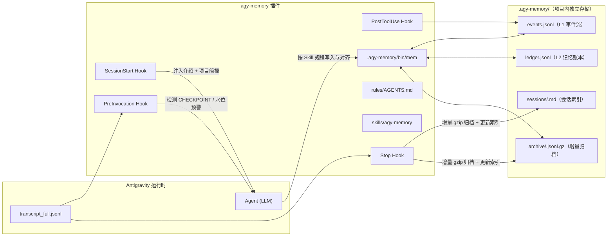

# agy-memory

[English](README.md) | 简体中文

**面向 Google Antigravity (`agy`) 的抗上下文压缩持久化记忆增强插件。**

零第三方依赖（仅需 Python 3.9+ 标准库） · 无需额外配置 API Key · 原生 Antigravity 插件（`hooks + rules + skill + CLI`）

---

## 一键安装（直接发给 Agent 自动安装）

直接复制下面这段话发给你的 Antigravity Agent，它会自动完成下载、校验、全局安装与清理：

```text
请帮我安装 agy-memory 记忆插件（仓库：https://github.com/Fangwenky/agy-memory-enhance）：先将仓库克隆到临时目录，运行 `agy plugin validate ./plugin/agy-memory --strict` 校验，再运行 `agy plugin install ./plugin/agy-memory` 全局安装，用 `agy plugin list` 确认已启用后删除临时目录。
```

> 如果只想安装到**当前项目工作区**（不影响其他项目，或便于团队共享），可发送：
> ```text
> 请把 https://github.com/Fangwenky/agy-memory-enhance 的 agy-memory 插件仅安装到当前工作区：克隆仓库到临时目录，执行 `sh scripts/install-dev.sh <当前工作区绝对路径>`，确认安装完成后删除临时目录。
> ```

---

## 为什么需要 `agy-memory`？

当对话上下文达到后端模型阈值时，Antigravity 会强制触发自动压缩（`SYSTEM/CHECKPOINT`），将早期的原始工具输出、文件内容和多轮推理替换为一段有损摘要 `<summary>`。虽然原生摘要对首条用户请求保留较好，但在长任务中依然存在以下典型问题：

1. **多次压缩叠加失真**：经历 2 次以上压缩后，"摘要的摘要"会抹平早期阶段工具输出中的精确标识符、配置键、符号名和中间结论。
2. **中途细节稀释**：在数十次工具调用中途追加的局部约束、设计决策和关键事实容易被改写或漏掉。
3. **跨会话失忆**：在同一仓库开启新会话时，先前会话确定的架构决策、禁令约束与未完成进度完全归零。
4. **摘要错误固化**：原生恢复规则要求模型将摘要内容视为已核实事实、不再复查；一旦摘要改写有误，错误会被一直沿用。

`agy-memory` 将**确定性的生命周期 Hooks**（无遗漏采集、压缩检测、自适应水位预警）与 **Agent 自主执行的 Skill 规程及 `mem` CLI** 结合：无需额外调用外部 LLM，由 Agent 自己在工作过程中维护只追加的记忆账本，并在压缩发生后对照原文指针进行精确对齐。

---

## 工作原理



### 三层存储结构（`<workspace>/.agy-memory/`）

- **L0 原文真值层（`archive/<convId>.jsonl.gz`）**：`Stop` 钩子在每轮结束时以多段 gzip 方式增量追加新增的 transcript。精确事实附带源指针（`<convId>#<step_index>` 或 `file:<path>`），即使原始日志被清理，仍可通过 `mem show <convId>#<step>` 取回原文片段。
- **L1 确定性事件流（`events.jsonl`）**：由 Hooks 自动追加写入（单次 `< 50ms`，不调 LLM），包含用户原话 `user_input`、文件修改 `file_edit`、终端命令 `command`、每轮 git 变更 `turn_end` 以及每次压缩的原生摘要原文 `compaction`。
- **L2 结构化记忆账本（`ledger.jsonl`）**：由 Agent 通过 `mem` CLI 维护，只追加不覆写：
  - **项目级作用域**：`constraint`（约束）、`decision`（决策及理由）、`fact`（带源指针的精确标识符），跨会话共享。
  - **会话级作用域**：`progress`（当前进度）、`open`（未决问题），按 `conversationId` 隔离，避免新会话或并行会话误继承别人的"下一步"。
  - 条目修订使用 `mem supersede <id> "..."`，保留完整演化链供长期追溯。

### 压缩前预警与压缩后对齐

1. **按模型自适应的水位预警**：`PreInvocation` 统计真实上下文大小（`input_tokens + cache_read_tokens`，消除缓存命中率波动干扰），并在 `state/models.json` 中自动学习每个模型实际发生压缩时的峰值；当上下文达到该峰值 75% 时注入一行轻量提醒，让 Agent 在压缩发生前主动存档。
2. **精确压缩检测**：主信号检测 transcript 新增步骤中的 `SYSTEM/CHECKPOINT`，辅以 40% 上下文骤降作为后备信号。
3. **结构化对齐流程**：压缩发生后自动重注当前会话简报（默认硬上限 `1500` tokens，按 `约束 > 本会话进度 > 决策 > 事实` 优先级裁剪），指引 Agent 加载 `agy-memory` skill 核查中途约束并从原文重新取回下一步所需的精确标识符。

---

## 评测结果

在 5 个多轮长任务（模型：`Gemini 4 Hydrogen Medium`，`agy` CLI 无头沙箱模式，隔离 git 工作区）上进行有/无插件对照评测，完整报告见 [`eval/RESULTS.md`](eval/RESULTS.md)：

| 评测指标 | Baseline（原生 `agy`） | 启用 `agy-memory` | 变化幅度 |
| :-- | :-- | :-- | :-- |
| **精确事实召回正确率** | 33 / 43（76.7%） | **42 / 43（97.7%）** | **+21.0 pp** |
| **事实丢失数** | 10 | **1** *（0 次记忆丢失，1 次首轮计数偏差）* | **下降 90.0%** |
| **约束复述正确率** | 11 / 12（91.7%） | **12 / 12（100%）** | **+8.3 pp** |
| **未缓存输入 + 输出 Tokens** | 4.04M | **4.15M** | **+2.7%** |

典型任务表现：
- **`t1`（中途追加约束 + 40 个模块，1 次压缩）**：`plugin` **5/5** vs `baseline` **1/5**。
- **`t4`（80 个模块，连续 2 次压缩）**：`plugin` **5/5** vs `baseline` **3/5**（`baseline` 在两次压缩后丢失了第 1、2 阶段所有工具输出中的模块密钥，而 `plugin` 准确完成 2 次对齐且总处理 tokens 更少）。
- **`t3`（跨会话接续）**：`plugin` **3/4** + 约束 **1/1** vs `baseline` **0/4** + 约束 **0/1**。

---

## 手动命令行安装

**环境要求**：macOS 或 Linux，`PATH` 中包含 `python3`（3.9 及以上），已安装 Antigravity（`agy` CLI / Antigravity 2.0 / IDE）。

### 方式一：通过 `agy plugin` 全局安装（推荐）

```sh
git clone https://github.com/Fangwenky/agy-memory-enhance.git
cd agy-memory-enhance
agy plugin validate ./plugin/agy-memory --strict
agy plugin install ./plugin/agy-memory
```

日常管理命令：`agy plugin list`、`agy plugin disable agy-memory`、`agy plugin enable agy-memory`。

### 方式二：仅安装到单个项目工作区

```sh
sh scripts/install-dev.sh /path/to/your/project
```

首次运行时，`.agy-memory/` 目录内会自动生成内容为 `*` 的 `.gitignore`（**不会修改项目根目录的 `.gitignore`**），防止本地日志或敏感信息被意外提交；如需随仓库提交项目记忆，删除 `.agy-memory/.gitignore` 即可。

---

## `mem` CLI 常用命令速查

Hooks 会在 `<workspace>/.agy-memory/bin/mem` 自动生成可执行启动脚本，并在 `[agy-memory]` 系统消息中告知路径：

```sh
# 写入与更新账本
.agy-memory/bin/mem add constraint "禁止修改 src/legacy/ 下的任何文件"
.agy-memory/bin/mem add decision "选用 SQLite 而非 Postgres：要求零外部依赖"
.agy-memory/bin/mem add fact "主注册键为 REG_03_327c8f" --source file:src/m03.py
.agy-memory/bin/mem add progress "完成第一阶段；下一步重构解析器"
.agy-memory/bin/mem done <id>
.agy-memory/bin/mem supersede <id> "更新后的规则描述"
.agy-memory/bin/mem drop <id>

# 查看简报与回溯原文
.agy-memory/bin/mem brief
.agy-memory/bin/mem show constraint          # constraint | decision | progress | fact | open | all
.agy-memory/bin/mem show <entry_id>          # 查看某条目的完整修订历史链
.agy-memory/bin/mem show <convId>#<stepIdx>  # 从实时 transcript 或 gzip 归档中读取原始步骤

# 长期追溯与自检
.agy-memory/bin/mem search "billing" --where all --since 7d
.agy-memory/bin/mem timeline --file src/core.py
.agy-memory/bin/mem session                  # 列出所有历史会话，或 `mem session <convId>` 查看单会话索引
.agy-memory/bin/mem doctor                   # 自检 Python 版本、存储目录权限、Hook 状态与日志可读性
```

---

## 可选配置（`.agy-memory/config.json`）

不创建配置文件时默认使用以下参数，按需覆盖即可：

```json
{
  "softLimitRatio": 0.75,
  "defaultSoftLimitTokens": 150000,
  "nudgeStepTokens": 30000,
  "compactionDropRatio": 0.4,
  "minPeakTokens": 60000,
  "briefMaxTokens": 1500,
  "sessionInjectBudgetTokens": 6000,
  "stopNudge": true,
  "stopNudgeEdits": 5,
  "archiveTranscripts": true,
  "editToolNames": ["write_file", "edit_file"],
  "redactPatterns": [
    "(?i)(api[_-]?key|secret|token|password)(\\s*[:=]\\s*)\\S+",
    "sk-[A-Za-z0-9_\\-]{16,}",
    "gh[pousr]_[A-Za-z0-9]{20,}"
  ]
}
```

---

## 已知局限

- **对齐信号延后一次模型调用**：Antigravity 的自动压缩发生在 `PreInvocation` 钩子执行**之后**、模型调用**之前**。因此压缩后的第一次模型调用只能依赖原生摘要运行，`[agy-memory]` 会在紧接着的下一次模型调用前注入对齐信号，并提醒 Agent 一并复核刚才那一步操作。
- **依赖内部 transcript 结构**：压缩检测通过读取 `transcript_full.jsonl` 中的 `SYSTEM/CHECKPOINT` 与 token 计数实现。若后续 Antigravity 版本调整内部日志格式，系统会自动回退到 token 骤降检测，并可通过 `mem doctor` 诊断。
- **操作系统支持**：当前版本支持 macOS 与 Linux（使用 `sh` 启动脚本与 `fcntl` 文件锁）。

---

## 开发与测试

```sh
# 运行全部 46 项单元、多进程并发、子进程 Hook、CLI 及 50MB 增量性能测试
python3 -W error::ResourceWarning -m unittest discover -s tests

# 插件清单与目录结构严格校验
agy plugin validate ./plugin/agy-memory --strict

# 评测打分器自检
python3 eval/selftest.py
```

## 开源协议

[MIT](LICENSE)
