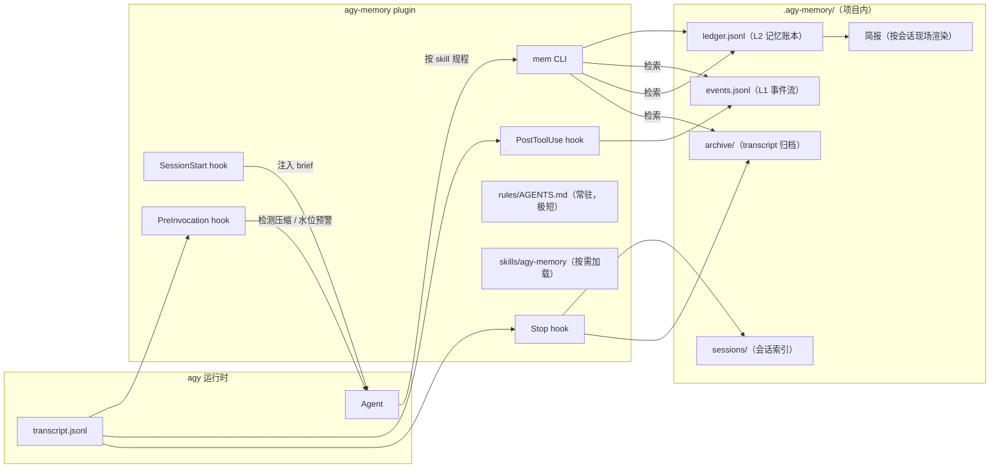
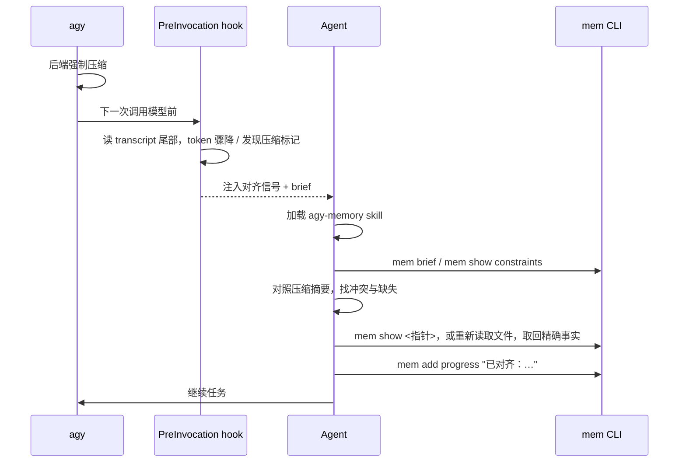

# agy-memory 设计文档

> 状态：草案（待确认） · 日期：2026-11-16 · 方案：B（skill + 少量 hook，打包为 plugin）

## 1. 意图

Antigravity（agy）的上下文到达后端阈值后会被强制压缩：原始工具输出、文件内容、早期约束被替换成一段有损的散文摘要。社区反馈的典型后果：

1. **符号/ID 漂移**：agent 依据摘要编造变量名、配置键、路径。
2. **约束失忆**：会话早期的规则（"不要改这个模块"）被改写或丢弃。
3. **重复劳动**：分不清哪些事已完成，重做已解决的问题、反复读同一批文件。

agy-memory 是一个面向社区的开源 plugin：**在任务运行时持续、独立地保存上下文；在压缩后让 agent 按规则检索并对齐关键内容；长期保留记录以支持长任务追溯**。最终目标是提升 harness 完成长任务的能力。

## 2. 目标 / 非目标 / 反目标

**目标**
- G1 压缩后必须保住：约束、决策、已完成事项、当前进度/下一步。
- G2 精确事实（路径、符号、ID、命令）不经摘要，只存"指针"，需要时回原文取。
- G3 压缩可感知、可预防：发现压缩已发生 → 自动触发对齐；上下文接近阈值 → 提前提示 agent 存档。
- G4 跨会话长期追溯：任意历史会话的决策、改动、用户原话可检索。
- G5 零配置可用：不需要 API key，不需要额外服务，装上即生效。

**非目标**
- 不修改、不替代 agy 自身的压缩机制。
- 不做通用知识库 / 向量检索（留给后续 MCP 版本）。
- 不跨机器同步。

**反目标（即使能跑也算失败）**
- hook 拖慢 agent：任何 hook 单次执行 > 300ms 视为缺陷。
- 记忆本身挤占上下文：注入内容失控变长，反而加速压缩。
- 记忆与事实冲突时被盲信：过期的记忆误导 agent。
- 频繁打断用户：为写记忆而反复强制 agent 多跑轮次。

## 3. 已知约束（来自 agy 文档与实测）

| 事实 | 对设计的影响 |
| :-- | :-- |
| hook 事件只有 `SessionStart` / `PreToolUse` / `PostToolUse` / `PreInvocation` / `PostInvocation` / `Stop`，**没有压缩事件** | 只能"持续写入 + 事后检测压缩 + 事前水位预警" |
| 每个 hook 的 stdin 都带 `conversationId`、`transcriptPath`、`workspacePaths`、`lastUserInput` | 采集可直接读 transcript，零遗漏，无需 agent 配合 |
| transcript 中每个 `PLANNER_RESPONSE` 步骤带 `input_tokens` / `cache_read_tokens`（在 Antigravity 2.0 的 `brain/<convId>/.system_generated/logs/transcript.jsonl` 中实测可见；文档未承诺，属内部格式） | 可据此估算上下文水位、检测压缩（token 骤降）。压缩时 transcript 是否只追加、hook 给出的 `transcriptPath` 是否同一格式、CLI/IDE 是否一致，均由 M0 确认 |
| `Stop` 每轮结束都会触发，**没有"会话结束"事件** | Stop 里只做增量、廉价的工作 |
| `SessionStart` **恢复旧会话时不触发**（M0 实测） | PreInvocation 必须兜底：发现该会话无 state 文件时视为首次，补注入简报 |
| 压缩时 transcript 只追加，并写入一个 `SYSTEM/CHECKPOINT` 步骤，内容以 `# Resuming from a compaction` 开头；注入过的 systemMessage 不会进入压缩摘要（M0 实测） | 以 CHECKPOINT 为主信号检测压缩；压缩后必须重新注入简报 |
| 压缩阈值与模型相关：Gemini 4 Hydrogen 约在 518k 时压缩（M0 实测），远高于社区报告的 140k–276k | 水位预警阈值按 `modelName` 学习，不写死 |
| `PLUGIN_ROOT` 只在 hook 进程中可见，agent 的 `run_command` 看不到；hook 进程的工作目录是 plugin 目录 | `mem` 的绝对路径必须由注入消息告诉 agent；存储路径一律取自 payload 的 `workspacePaths` / `cwd` |
| 注入的 `systemMessage` 会持久留在会话中 | 注入内容本身会占用上下文，必须控制总量 |
| hook 同步执行、阻塞 agent 循环，默认超时 30s | hook 内不调 LLM、不做重计算，只做追加写和轻量判断 |
| `PreInvocation` / `SessionStart` 可注入持久化 `systemMessage` | 对齐信号与简报的注入通道 |
| `Stop` 可返回 `decision: continue` 让 agent 继续 | 可用于"收尾时更新记忆"，但需节制（见反目标） |
| plugin 的 hook 获得 `PLUGIN_ROOT`；`PLUGIN_DATA` 只有已安装的 plugin 才有，workspace 内的 plugin 为 null（M0 实测）；`hooks.json` 必须位于 plugin 根目录 | 打包结构固定；退回路径不能依赖 `PLUGIN_DATA` |
| always-on rules 共享 20k token 预算，单文件 ≤ 24KB | 常驻 rule 必须极短，详细规程放 skill |

## 4. 方案选择

| 方案 | 描述 | 取舍 |
| :-- | :-- | :-- |
| A 纯 skill + 常驻 rule | 写入、对齐全靠 agent 自觉 | 最轻；但 agent 压缩后不知道自己忘了，触发不可靠 |
| **B skill + 少量 hook（选定）** | hook 负责确定性的采集、检测、注入；agent 按 skill 规程负责提炼、检索、对齐 | 兼顾轻量与可靠；需少量脚本；压缩检测需先实验确认 |
| C skill + MCP server | 结构化 memory 工具 + 检索引擎 | 查询最强；安装与维护成本高，作为后续升级方向 |

选 B 的理由：最容易出错的"触发"和"采集"交给不会遗忘的 hook；需要判断力的"提炼"和"对齐"交给 agent 本身（agent 就是 LLM，因此无需 API key）。

## 5. 总体架构



职责划分：

- **hook（确定性，无 LLM）**：采集事件、检测压缩、水位预警、注入简报、会话收尾归档。
- **agent（按 skill 规程）**：把对话提炼成约束/决策/进度/事实条目写入账本；压缩后执行对齐流程；需要时检索历史。
- **mem CLI**：agent 与存储之间唯一的读写接口（保证格式、加锁、渲染简报）。

## 6. 存储设计

位置：`<workspace>/.agy-memory/`（多工作区时取 `workspacePaths[0]`；无工作区时退回 `${PLUGIN_DATA:-~/.agy-memory}/projects/<cwd 的哈希>/`）。首次创建时在目录内写入 `.agy-memory/.gitignore`（内容为 `*`），**不修改用户自己的 `.gitignore`**；想提交记忆的用户删掉这个文件即可。`redactPatterns` 作用于所有写入内容（事件、账本、归档）。

```text
.agy-memory/
├── config.json          # 阈值与开关（缺省即用默认值）
├── events.jsonl         # L1：hook 自动写入，只追加
├── ledger.jsonl         # L2：agent 经 mem CLI 写入，只追加（更新=追加新版本）
├── state/<convId>.json  # 每会话 hook 状态：上次 token 水位、已注入标记等
├── sessions/<convId>.md # 每会话索引：时间、首条用户请求、改动文件、账本条目
├── archive/<convId>.jsonl.gz  # transcript 归档（可关）
└── bin/mem              # 指向 plugin 内 mem 脚本的 shim，由 hook 生成
```

### L0 原始记录：只存指针 + 归档

不复制原文到账本。指针格式：`<convId>#<step_index>`，或 `file:<path>@<git-sha|mtime>`。

归档采用**增量追加**：每次 Stop 只把上次偏移之后新增的 transcript 行压成一个 gzip member 追加到归档文件末尾。gzip 允许多个 member 直接拼接，读取时就是完整文件。单次开销只和本轮新增内容成正比。若 M0 发现 transcript 会在压缩时被改写，则检测到文件变小时从头另起一个归档段。

### L1 事件流 `events.jsonl`（hook 写入）

每行一个事件，字段：`ts, convId, step, kind, data`。`kind` 取值：

| kind | 来源 | data |
| :-- | :-- | :-- |
| `user_input` | PreInvocation（检测到新的 `lastUserInput`） | 用户原话全文（约束常出现在原话里） |
| `file_edit` | PostToolUse（写文件类工具） | 路径、工具名、是否报错 |
| `command` | PostToolUse（`run_command`） | 命令行、是否报错 |
| `token_mark` | PreInvocation | 当前 input_tokens |
| `compaction` | PreInvocation 检测 | 前后 token 值、判定依据 |
| `checkpoint_nudge` / `align_nudge` | PreInvocation | 注入了什么 |
| `turn_end` | Stop | terminationReason；若在 git 仓库中，附带 `git diff --name-only` 结果，用来补上经 `run_command` 改动、工具层面看不到的文件 |

### L2 记忆账本 `ledger.jsonl`（agent 写入）

条目字段：`id, ts, convId, type, text, source[], status, supersedes?`

| type | 含义 | 例子 |
| :-- | :-- | :-- |
| `constraint` | 必须遵守的规则 | "不要修改 `src/legacy/`" |
| `decision` | 已做的决策及理由 | "用 SQLite 而非 Postgres，因为要零依赖" |
| `progress` | 当前任务、已完成、下一步 | "M1 完成；下一步写 PreInvocation 检测" |
| `fact` | 精确标识符，必须带 source 指针 | "配置键 `memory.softLimit`，见 `conv#123`" |
| `open` | 未决问题 | "压缩标记的确切形态待确认" |

`status`：`active` / `superseded` / `done`。更新不改原行，而是追加新条目并通过 `supersedes` 指向旧条目，从而保留完整演化史，供长期追溯。

**作用域**：账本条目分两类。
- **项目级**：`constraint` / `decision` / `fact`。对该项目的所有会话生效。
- **会话级**：`progress` / `open`。属于写入它的 `convId`。

这样，同一项目下并行的两个会话，或明天开始的新任务，不会被注入别人的"当前进度"。

### 简报

简报不落成单一文件，而是按会话现场渲染（`mem brief --conv <id>`）。内容依次为：
1. 全部 active 约束；
2. 最近的决策；
3. **本会话的** progress 与未决问题；
4. 事实的标题与指针（不展开原文）；
5. 一行"其他会话有未完成任务：<标题>（`mem session <id>` 查看）"。agent 只在用户要求接续时才去看。

**硬上限默认 1500 tokens**，按字符数估算：CJK 字符按 1 token 计，其余按 4 字符 1 token 计。超限时按"约束 > 本会话进度 > 决策 > 事实"的优先级截断，并附一句"完整内容见 `mem show`"。

## 7. 运行流程

### 7.0 注入预算
注入内容会持久留在会话里，所以全部注入都要受控：
- **完整简报**只在两个时机注入：会话首次调用、每次压缩之后。压缩后再注入一次是必要的，因为压缩可能连之前注入的简报一起压掉。M0 会确认这一点。
- **水位预警**和**收尾提醒**一律只有一行，不附带简报。
- 每个会话设注入总量上限 `sessionInjectBudgetTokens`，默认 6000。超出后只发一行提示，内容为"运行 `mem brief` 查看"。

### 7.1 SessionStart，以及恢复会话时的兜底
1. 确保 `.agy-memory/bin/mem` shim 存在。它是一个 sh 脚本，内部执行 `exec python3 "<PLUGIN_ROOT>/skills/agy-memory/scripts/mem" "$@"`。
2. 如果账本非空，注入简报和 `mem` 的绝对路径，格式如下："本项目启用 agy-memory。记忆命令：`<abs>/.agy-memory/bin/mem`。简报：……"。
3. 写入该会话的 state 文件。

恢复旧会话时 SessionStart 可能不触发。因此 PreInvocation 发现某会话没有 state 文件时，也按上述 1–3 处理。

### 7.2 PostToolUse
matcher 为一组尽力识别的写文件类工具名加上 `run_command`。具体名单由 M0 确定，并做成可配置项。不用 `"*"`，以免每次工具调用都多启动一次 Python 进程。

处理方式是向 `events.jsonl` 追加一条 `file_edit` 或 `command` 事件。只追加，不读 transcript，目标耗时 < 50ms。经 `run_command` 改动的文件这里漏掉也没关系，由 Stop 阶段的 `git diff` 补上。

### 7.3 PreInvocation（核心）
1. 增量读取 transcript 尾部：按 state 中记录的字节偏移读取，不全量扫描。如果文件比偏移还小，说明被改写过，从头重读并重置偏移。
2. 发现新的用户输入时，记录 `user_input` 事件。
3. **压缩检测**：满足任一条件即判定压缩已发生：
   - (a) **主信号**：新增步骤中出现 `type == "CHECKPOINT"`。M0 实测可靠；
   - (b) 后备信号（防止 agy 改格式）：最新可见的**上下文大小**（`input_tokens + cache_read_tokens`；`input_tokens` 只计未命中缓存的部分，单看它会因缓存波动而误报，见 `spike/FINDINGS.md`）比"自上次压缩以来的峰值"低 ≥ `compactionDropRatio`（默认 40%），且该峰值 ≥ `minPeakTokens`（默认 60k）。**判定压缩后峰值清零**，这样第二次、第三次压缩也能检测到。

   判定后：记录 `compaction` 事件，**事件中附带 CHECKPOINT 摘要原文**（供长期追溯，以及和账本对照）；在 `state/models.json` 中记下该 `modelName` 的压缩峰值；并注入对齐信号，内容为"检测到上下文已被压缩。在继续之前，加载 agy-memory skill 并执行对齐流程。"，后附简报和 `mem` 路径。每次压缩只注入一次，由 state 去重。
4. **水位预警**：同时满足两个条件时注入一行提示：
   - 上下文大小 `≥` 软上限。软上限 = `softLimitRatio`（默认 0.75）× 该模型最近一次观测到的压缩峰值；还没有观测数据时用 `defaultSoftLimitTokens`（默认 150k，偏保守）。且距上次预警又增长了 ≥ `nudgeStepTokens`（默认 30k；从上次预警时的水位起算，首次从软上限起算）；
   - 上次预警之后账本没有更新过。

   提示内容为"上下文接近压缩阈值，请先用 `mem` 把约束、决策、进度写入账本，再继续。"这一步就是"可控压缩"的替代：在压缩发生前主动存档。

### 7.4 Stop（每轮结束都会触发）
- 只做增量、确定性的工作，不需要 agent 参与：
  - 写入 `turn_end` 事件；
  - 更新 `sessions/<convId>.md`；
  - 增量追加归档（见 §6 L0）。
- **收尾提醒**（可关，默认开）：同时满足以下条件时返回 `decision: continue`，理由为"请用 mem 更新账本后结束"，否则放行：
  - `terminationReason == NO_TOOL_CALL`；
  - `continuationActive == false`（这一条本身就保证每轮最多触发一次）；
  - 自上次写账本以来 `file_edit ≥ stopNudgeEdits`（默认 5）。

### 7.5 压缩检测与对齐的时序



## 8. Skill 与常驻 rule

### `rules/AGENTS.md`（常驻，目标 < 300 tokens）
只写协议要点：
- 本项目启用了 agy-memory。
- 出现以下情况时用 `mem add` 记录：用户给出约束、做出关键决策、完成里程碑。
- 收到"检测到压缩"或"水位预警"的系统消息时，加载 agy-memory skill 并照做。
- 路径、ID 等精确事实以原文为准，不以摘要为准。

### `skills/agy-memory/SKILL.md`（按需加载）
包含四套规程，可拆成 references：

1. **写入规程**：什么值得记（约束、决策、进度、事实、未决问题），条目怎么写（一条一事、带 source 指针），何时更新或作废旧条目。
2. **对齐规程**（压缩后）：
   1. 读取 brief；
   2. 逐条核对 active 约束是否仍体现在当前理解中；
   3. 下一步要用到的标识符一律回原文取：`mem show <指针>` 或重新读取文件；
   4. 写一条 progress 记录"已对齐"；
   5. 继续任务。
3. **检索规程**（长期追溯）：`mem search`、`mem timeline`、`mem session <convId>` 的用法，以及如何从事件流回溯"某个文件为什么被改成这样"。
4. **冲突处理**：记忆与当前代码或事实不一致时，以事实为准，并把旧条目标记为 superseded。

## 9. `mem` CLI

单文件 Python 3 脚本，只用标准库，随 plugin 分发（`skills/agy-memory/scripts/mem`）。agent 通过 `run_command` 调用。

| 命令 | 作用 |
| :-- | :-- |
| `mem add <type> "<text>" [--source ptr]... [--supersedes id]` | 追加账本条目；会话级条目自动带上当前 convId |
| `mem done <id>` / `mem supersede <id> "<new text>"` | 更新条目状态 |
| `mem brief [--conv id]` | 输出简报（不带参数时取最近活跃的会话） |
| `mem show <id \| type \| 指针>` | 展开条目，或按指针取回 transcript / 归档中的原文片段 |
| `mem search <query> [--type] [--since]` | 在账本、事件流、归档中做关键词检索 |
| `mem timeline [--since] [--file path]` | 按时间列出事件和账本变化 |
| `mem session [convId]` | 列出会话，或查看单个会话索引 |
| `mem doctor` | 自检：目录、配置、hook 是否生效，最近一次压缩检测是否正常 |

调用方式：agent 使用注入消息里给出的 shim 绝对路径（`<workspace>/.agy-memory/bin/mem`）。shim 根据自身所在位置确定存储目录，不依赖 agent 的环境变量或 cwd。当前 convId 由 hook 写入 `state/current` 提供，agent 也可以用 `--conv` 显式指定。并发写入使用文件锁（`fcntl`）。

**平台**：第一版支持 macOS 和 Linux，要求 PATH 中有 `python3`（3.9 及以上），`mem doctor` 负责检查。Windows 留到后续版本。

## 10. 配置 `config.json`（全部可选）

```json
{
  "softLimitRatio": 0.75,
  "defaultSoftLimitTokens": 150000,
  "nudgeStepTokens": 30000,
  "compactionDropRatio": 0.4,
  "minPeakTokens": 60000,
  "briefMaxTokens": 1500,
  "sessionInjectBudgetTokens": 6000,
  "editToolNames": ["write_file", "edit_file"],
  "stopNudge": true,
  "stopNudgeEdits": 5,
  "archiveTranscripts": true,
  "redactPatterns": ["(?i)api[_-]?key\\s*[:=]\\s*\\S+"]
}
```

## 11. 插件结构

```text
agy-memory/
├── plugin.json
├── hooks.json
├── hooks/
│   ├── session_start.py
│   ├── pre_invocation.py
│   ├── post_tool_use.py
│   ├── stop.py
│   └── common.py          # stdin 解析、存储定位、锁、transcript 增量读取
├── rules/AGENTS.md
├── skills/agy-memory/
│   ├── SKILL.md
│   ├── references/{write,align,recall}.md
│   └── scripts/mem
├── tests/fixtures/        # 录制的 transcript 片段（含压缩前后）
└── README.md
```

## 12. 验证

- **单元测试**：用 fixture transcript 和 stdin payload 回放每个 hook，断言事件、注入内容、去重逻辑都正确。
- **性能**：在 50MB 的 transcript 上测 PreInvocation 的增量读取，单次 < 300ms。
- **效果评测**（项目价值所在）：
  - **任务**：设计 5 个必然触发**至少 2 次**压缩的长任务，例如多模块重构、按长规格逐步实现。M0 的经验是：约束写在首条消息里、任务自带状态文件时，原生摘要就足够了。所以评测任务必须做到以下几点：
    - 约束和决策**分散在中途的多轮对话里**下达；
    - 精确标识符来自工具输出，而不是用户原话；
    - 任务不要求把状态写进文件；
    - 至少一个任务跨两个会话。
  - **对照**：分别在"有 plugin"和"无 plugin"两种条件下运行，每个任务每种条件各跑 3 次，共 30 次。模型和设置固定。
  - **主要指标**：约束违反次数、标识符幻觉次数。
  - **次要指标**：重复读取或重复劳动的步骤数、任务完成率、账本写入率、额外 token 开销。

## 13. 里程碑

| 阶段 | 内容 | 退出条件 |
| :-- | :-- | :-- |
| M0 实验 | 在 Antigravity 2.0 中用长任务把上下文推过阈值，故意触发 ≥ 2 次压缩；记录 transcript、hook payload 在压缩前后的变化；在 CLI 上也复核一次 | 回答以下问题：transcript 是否只追加；压缩有无显式标记；`input_tokens` 是否骤降；注入的 systemMessage 压缩后是否还在；SessionStart 恢复会话时是否触发；写文件类工具的名称 |
| M1 采集与注入 | 存储层、PostToolUse、SessionStart、PreInvocation（检测 + 水位预警） | fixture 测试通过；真实会话中压缩检测命中率 100%（M0 中录制的样本），误报 0 |
| M2 skill 与 CLI | `mem` CLI、SKILL.md、rule、Stop 收尾 | 在 M0 的任务上，agent 能在压缩后按规程完成对齐 |
| M3 评测与发布 | 效果评测、README、示例 | 两项主要指标合计下降 ≥ 50%，额外 token 开销 ≤ 10%；达标后发布到社区 |

**M0 的降级路径**：
- 如果 transcript 中没有可用的 token 数据，也没有压缩标记，则退回"降级模式"：
  - 用 transcript 字节增长量估算水位，继续做水位预警；
  - 压缩检测改为检查"transcript 文件变小或被改写"；
  - 如果连这一信号也没有，就改为每 N 次调用注入一行"如有疑问请运行 `mem brief`"。
- 降级模式下项目继续推进，并在 README 中说明能力受限。

## 14. 风险

- **压缩信号不稳定**：transcript 结构属于产品内部实现，可能随版本变化。缓解：同时使用"标记"和"token 骤降"两种检测；`mem doctor` 能提示失效。
- **agent 不照规程写账本**：缓解：水位预警和 Stop 收尾兜底；评测中单独统计账本写入率。
- **记忆过期误导**：缓解：条目带 source 和时间；对齐规程要求精确事实回原文核对。
- **隐私**：记忆可能含密钥。缓解：目录内自带 `.gitignore`；所有写入内容按 `redactPatterns` 脱敏。
- **注入挤占上下文**：缓解：§7.0 的注入预算；M3 统计额外 token 开销。

## 15. 留给实现者决定

- 增量读取的具体实现、锁的实现方式。
- `mem search` 的排序方式（第一版用关键词加时间倒序即可）。
- 会话索引 `sessions/*.md` 的具体排版。
- 测试框架的选择。

## 16. 我替你做的决定（请审阅）

1. 实现语言选用 **Python 3 标准库**：社区覆盖面广，零依赖。第一版只支持 macOS 和 Linux。备选是 Go 单二进制，分发更省心，但开发更重。
2. 存储放在**项目内的 `.agy-memory/`**，目录内自带 `.gitignore`，不修改用户自己的 `.gitignore`。没有工作区时退回到 plugin 数据目录。
3. **默认增量归档 transcript**，保证长期指针不失效，代价是磁盘占用。
4. 默认阈值（120k 预警、40% 骤降判压缩、1500 tokens 简报上限、每会话 6000 tokens 注入上限）参考社区报告的 140k–276k 压缩区间，M0 之后再校准。
5. Stop 收尾提醒**默认开启**，但有编辑数门槛，每轮最多触发一次。
6. **记忆分作用域**：约束、决策、事实是项目级的；进度、未决问题是会话级的。新会话只会看到"其他会话有未完成任务"这一行。
7. M3 的达标线定为：主要指标下降 ≥ 50%，额外 token 开销 ≤ 10%。
8. M0 如果找不到可靠的压缩信号，**项目继续，进入降级模式**，不中止。
